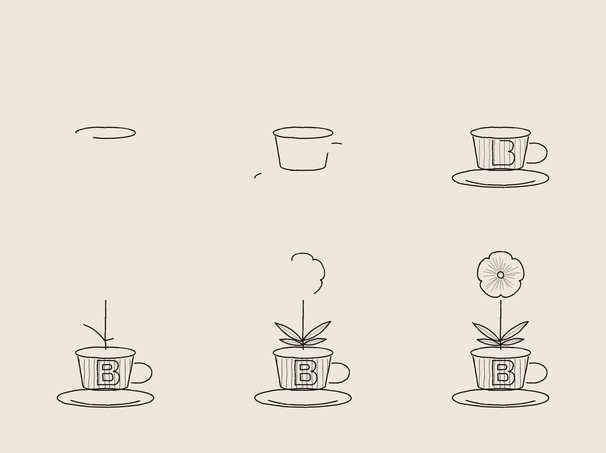

# Café Botánico — Zaragoza

Boceto de web para Café Botánico (C/ Santiago 3-5, Pasaje del Ciclón, Zaragoza).
HTML/CSS/JS plano, sin build ni dependencias: se abre `index.html` y funciona.

```bash
python3 -m http.server 4321
```

## Estética

Sacada de su Instagram, no de una plantilla:

- **Pared crema con grano de carrete** sobre toda la página.
- **Letras desparejadas** en el titular, cada una de un tipo, cuerpo, color e
  inclinación distintos — como las letras de rastro de la pared del local.
- **Fotos como copias de laboratorio**: borde blanco, giro ligero, sombra y, en
  el hero, un trozo de cinta de carrocero.
- **Papel pintado floral** de fondo en "La casa", dibujado en SVG.
- **Pizarra con marco de madera** para las tartitas.
- **Bloque de noche** para tés y cócteles, con la luz de las guirnaldas.
- Paleta tomada de sus fotos: crema, rojo teja, verde monstera, azul desvaído,
  rosa del papel pintado.
- Tipografías: **Oswald** (condensada, como el logotipo y los rótulos antiguos)
  y **Fraunces** con los ejes `SOFT` y `WONK` para los titulares.

## La intro

Sólo el logo, ~4,2 s. Se reproduce **una vez por sesión** (`sessionStorage`),
se salta con el botón o un clic, se desactiva sola con `prefers-reduced-motion`
y se puede repetir desde el pie.

| t | qué pasa |
|---|---|
| 0,15 s | se dibuja la taza: boca, cuerpo, asa y plato |
| 1,0 s | aparece el rayado vertical del cuerpo |
| 1,05 s | se dibuja la **B** |
| 1,5 s | sale el tallo de la taza |
| 1,85 s | se abren las cuatro hojas |
| 2,28 s | florece la flor y aparece su sombreado |
| 3,15 s | entra **CAFE BOTANICO** |



El logo está **redibujado en SVG** a partir del original, con sus cinco pétalos,
el sombreado a lápiz, las cuatro hojas, el rayado de la taza y la B perfilada.
Lo genera `genlogo.py` (ver abajo) y lleva un filtro `feTurbulence` para que el
trazo no salga perfecto. El wordmark va en Oswald 600, que es lo más parecido a
la condensada del logotipo real.

## Estructura

```
index.html
assets/css/style.css
assets/js/main.js
assets/logo.svg.html   logo completo, inyectado en la intro
assets/mark.svg.html   versión compacta para cabecera y pie
assets/img/            fotos
```

## Pendiente de datos reales

- **Horario**: el del bloque "Visítanos" es inventado.
- **Carta**: las tartitas salen de su pizarra, pero los precios son de ejemplo.
  Lo mismo con tés y cócteles.
- **Textos**: redactados a ojo, a validar con el local.
- **Fotos**: casi todas son recortes de la retícula de Instagram, de baja
  resolución. Hacen falta los originales.
